# Sedhep

A private, offline-first family cookbook for Android, iOS and the desktop. Recipes are written and
kept on the device; they travel to other phones directly, over the local network, without an
account, a server or a subscription.

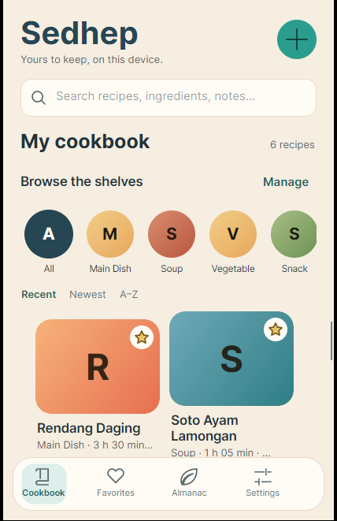

## What is in the app

**The cookbook.** Covers first: each recipe is a little book on the shelf, in its own warm colours
when there is no photograph. Categories are shelves you tap, and the list has three orders (recent,
newest, A–Z). Search reads the local database and covers names, ingredients, steps, notes and tags —
it works with no connection at all.

**The ingredients almanac.** The plan's one distinctive idea: every ingredient any recipe mentions
gets its own card, filed under the shelf it belongs to (produce, protein, spice, herb, grain, dairy,
sweetener, pantry), with the measure you usually write for it and every recipe that calls for it.
The almanac is built from the recipes themselves, so it needs no maintenance and can never drift out
of date. It is the quickest answer to “what can I cook with what is in the kitchen?”

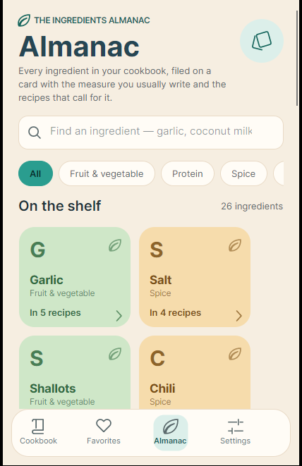

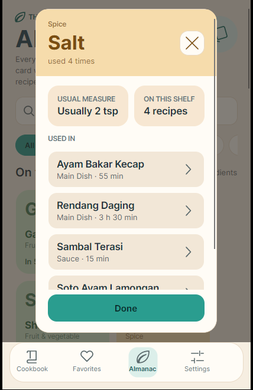

**Recipes.** A name is the only required field. Everything else — photo, description, category,
times, servings, ingredients, ordered steps, notes, tags — is optional and can be filled in as the
recipe is used. Ingredients and steps can be added, reordered and removed one row at a time.

**Cooking mode.** One step at a time in large type, a tick-off ingredient list, a timer for steps
that carry a duration, and no way to edit anything by accident.

**Categories.** The nine from the plan are created on first run and can be renamed, added to and
deleted. Deleting a category never deletes a recipe: those recipes move to “No category”.

**Sharing between devices.** Phones on the same Wi-Fi find each other and exchange whole cookbooks
or single recipes. The receiving device is shown who is sending and how much is coming, and nothing
is transferred until the person holding it says yes. The connection is encrypted with a key both
devices derive from an ephemeral Diffie–Hellman exchange, so the recipes are not readable on the
way. No accounts, no cloud.

**Backups.** The whole cookbook can be written to a `.cookbook` file and opened again on another
device. That file is a zip holding `manifest.json` (with the format version), `recipes.json`, and
the photo files.

**Two copies of the same recipe.** When an import finds a recipe that already exists here and the
incoming one is not clearly newer, nothing is overwritten: the recipe is shown with both revisions
and the user chooses “Keep my version” or “Use the incoming version”, once per recipe.

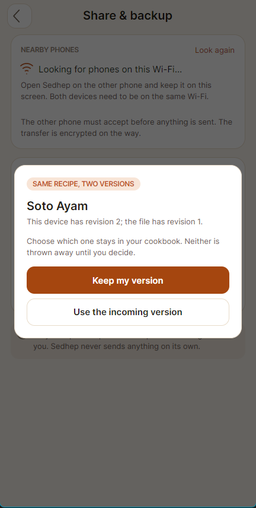

**Settings.** Light, dark or system theme, three text sizes that scale the whole app (cooking mode
included), the device name other phones see, and where the cookbook is stored. On the desktop the
cookbook location is a folder you can open, copy and change from this page.

| | | |
|---|---|---|
| 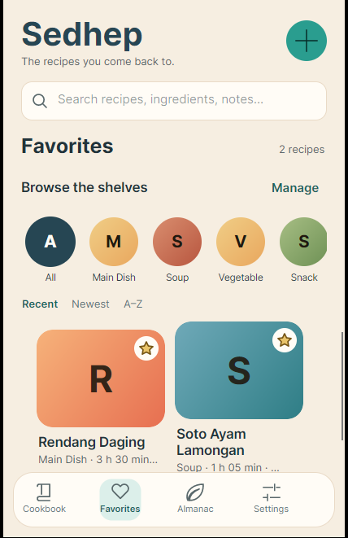 | 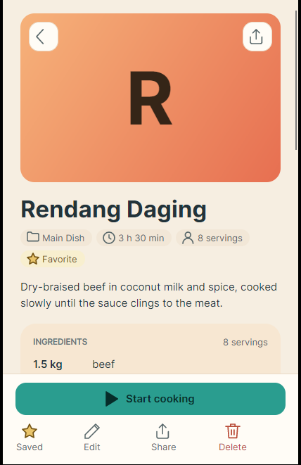 | 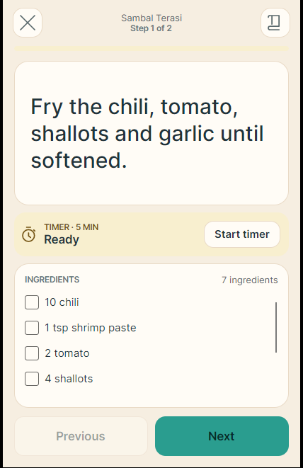 |
| 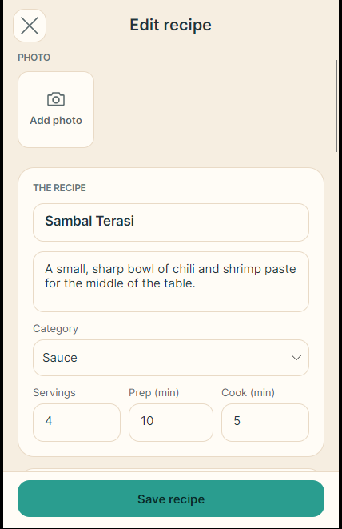 | 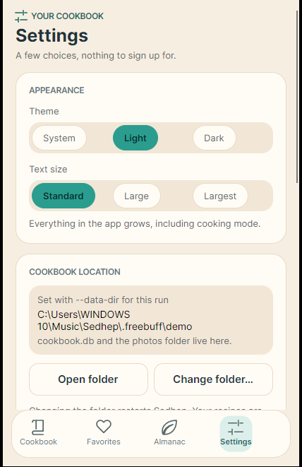 | 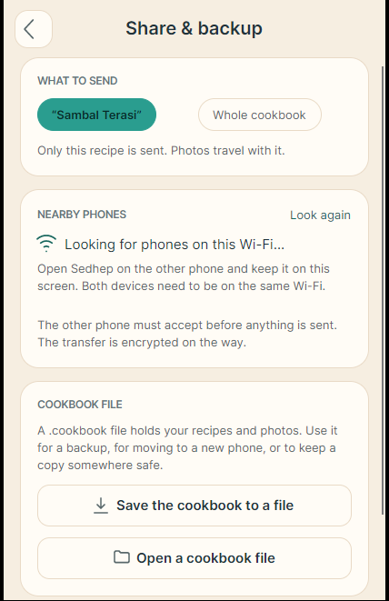 |

Dark theme:

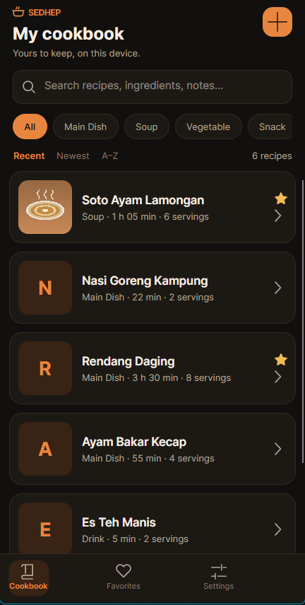

## How it is put together

```
src/Sedhep.Domain          recipes, categories, sync metadata, sharing contracts
src/Sedhep.Infrastructure  SQLite persistence, photo storage, .cookbook files, LAN transfer
src/Sedhep                 Avalonia UI: view models, views, styles, navigation
platforms/                 Android, iOS, browser and desktop hosts
```

The UI depends on the domain interfaces only. The sharing transport knows nothing about recipes: it
moves an encrypted package and hands it to the cookbook file reader on the other side.

The almanac is a view, not a second source of truth: `IngredientAlmanac` groups the structured
ingredient rows the cookbook already stores, so no glossary needs to be maintained by hand and a
recipe edit shows up on the cards immediately.

Data choices worth knowing:

- One SQLite connection, opened and migrated on first use, with WAL and foreign keys on.
- Saving a recipe writes the recipe, its ingredients, steps and photos in one transaction.
- Every recipe carries a revision number that is bumped on save, and deletions leave a tombstone,
  so two cookbooks can be compared without trusting either device's clock.
- Photos are stored as files next to the database and decoded one at a time, never all at once.

## Running it

```bash
# desktop (Windows, macOS, Linux)
dotnet run --project platforms/Sedhep.Desktop

# Android / iOS / browser hosts exist too and build with the matching workloads
dotnet build Sedhep.slnx
```

If you open the solution in an IDE, make **Sedhep.Desktop** the startup project. With the Android
head selected, the IDE tries to deploy to an emulator instead of starting the desktop app.

## Where the cookbook lives

`%LOCALAPPDATA%\Sedhep` on Windows, the equivalent per-user data folder elsewhere:

- `cookbook.db` — recipes, ingredients, steps, categories, revisions and deletion tombstones
- `photos/` — one folder per recipe
- `settings.json` — device name, theme, text size

### Choosing the folder on the desktop

The folder is a normal folder on disk, and the desktop app can open it, move to another one, or
copy the cookbook between them:

- **Settings → Cookbook location → Change folder…** opens the native folder picker. Pick any folder
  you can write to. If it already contains `cookbook.db`, Sedhep opens that cookbook. If it is
  empty and the current folder has a cookbook, Sedhep offers to copy `cookbook.db`, the photos and
  the settings there — the original folder is left exactly as it was.
- The recovery screen shown when the folder cannot be written offers the same picker. A cookbook in
  a read-only, admin-owned or sandboxed folder can be copied to a folder Sedhep can use instead of
  leaving the app at a dead end.
- The choice is remembered and Sedhep restarts to open the new folder cleanly.

The note that remembers the folder is `%APPDATA%\Sedhep\cookbook-location.json`. Because a profile
can itself be locked down, Sedhep also tries the local profile, the app's own folder and the temp
folder, and uses the first note it can read. If none of them can be written, the app says so rather
than pretending the choice will survive a restart.

### Command line and environment

To keep the cookbook somewhere else for a run — a portable install, a demo, or a machine where the
default folder is read-only — use either form:

```bash
Sedhep.Desktop.exe --data-dir "D:\Sedhep"
# or
set SEDHEP_DATA_DIR=D:\Sedhep
```

`--data-dir` applies to that run only. A folder chosen inside the app is remembered and wins on
later starts; `SEDHEP_DATA_DIR` is used when no folder has been chosen in the app.

If the folder cannot be written, Sedhep does not crash: it opens a recovery screen that names the
folder, explains the likely cause, and offers to choose another folder (copying the cookbook if you
ask), copy the folder path, or open it in the file manager. Your cookbook is never moved or deleted
behind your back — a read-only location is reported, not silently worked around.

## Tests

```bash
dotnet test tests/Sedhep.Tests
```

The suite runs against a real SQLite file and a real photo folder, and covers the parts where a
mistake would cost the user recipes: saving children in one transaction, revision bumps, tombstones
on delete, category deletion keeping its recipes, search across tags/ingredients/notes, the
`.cookbook` round trip (including photos), refusing a newer file format, and the conflict rule with
both answers.

## Deliberately not here yet

The plan's “could have” list: voice recipe entry, step photos, ingredient scaling, printable
cookbooks, optional cloud backup, field-level merging of two edited copies (today the whole recipe
is chosen, not individual fields), and a sync screen that reconciles two live cookbooks — the
revision numbers and tombstones it needs are already stored.

There is no public feed, no likes, no accounts and no analytics — and there will not be.
